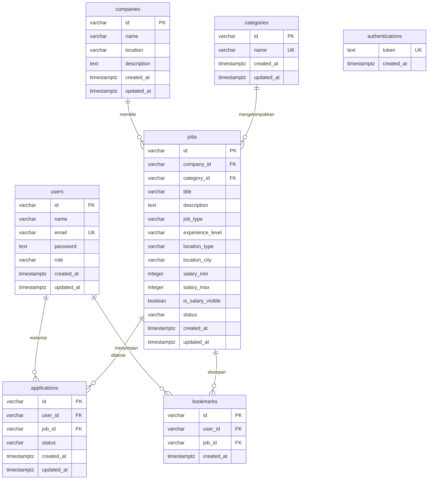

# OpenJob RESTful API V1 — Brief untuk Agent

> Dokumen ini adalah **spesifikasi lengkap** untuk membangun RESTful API OpenJob (aplikasi rekrutmen internal).
> Target: **semua kriteria level Advanced** (Kriteria 1 = 4 pts, Kriteria 2 = 4 pts), dan **seluruh test Postman (wajib + opsional) lulus tanpa error**.
> Spesifikasi di bawah diturunkan dari rubrik penilaian dan dari assertion di koleksi Postman `[271] OpenJob API Test V1`. Jika ada konflik, **koleksi Postman adalah sumber kebenaran** untuk bentuk request/response.

---

## 0. Aturan Kerja Agent

1. Kerjakan berurutan sesuai **Bagian 12 (Fase Implementasi)**. Jangan lompat ke endpoint sebelum migrasi dan auth selesai.
2. Setelah tiap fase, jalankan server dan cek manual dengan `curl`. Di akhir, jalankan koleksi Postman lewat **Newman** (Bagian 13).
3. Jangan menulis kredensial/secret di kode. Semua dari `.env`.
4. Jangan memakai session/cookie untuk autentikasi (otomatis **Reject**). Hanya JWT Bearer.
5. Jangan memakai database selain PostgreSQL (otomatis **Reject**).
6. Jangan mengubah isi koleksi Postman. Aplikasi yang menyesuaikan diri dengan test, bukan sebaliknya.
7. Di akhir, laporkan: hasil Newman (jumlah request/assertion, gagal berapa), dan centang checklist Bagian 14.

---

## 1. Tech Stack

| Kebutuhan | Pilihan |
|---|---|
| Runtime | Node.js (LTS), CommonJS |
| Framework | Express.js (v5 boleh; jika v4, bungkus handler async dengan `asyncHandler`) |
| Database | PostgreSQL |
| Driver | `pg` (Pool) |
| Migrasi | `node-pg-migrate` (**wajib**) |
| Validasi | `joi` (direkomendasikan) |
| Auth | `jsonwebtoken` |
| Hash password | `bcryptjs` (tanpa native build) |
| Env | `dotenv` |
| Dev server | `nodemon` |
| Uji | `newman` (devDependency, untuk menjalankan koleksi Postman) |
| ID | `crypto.randomUUID()` dengan prefix, mis. `user-<uuid>` (tanpa dependency tambahan) |

---

## 2. Struktur Proyek

```
openjob-api/
├── .env                      # TIDAK di-commit
├── .env.example              # di-commit
├── .gitignore                # node_modules, .env
├── package.json
├── ERD-OpenJob-versi-1.png   # WAJIB (Bagian 5.4)
├── docs/erd.mmd              # sumber Mermaid ERD
├── postman/                  # salin koleksi + environment dari zip
├── migrations/               # dibuat oleh node-pg-migrate (nama berawalan timestamp)
└── src/
    ├── server.js             # entry: load env, app.listen(PORT, HOST)
    ├── app.js                # express app, routes, notFound, errorHandler
    ├── config/db.js          # pg Pool dari PG* env
    ├── exceptions/           # ClientError, InvariantError(400), AuthenticationError(401), AuthorizationError(403), NotFoundError(404)
    ├── middlewares/
    │   ├── auth.js           # verifikasi Bearer access token
    │   ├── validate.js       # factory middleware Joi
    │   ├── notFound.js
    │   └── errorHandler.js
    ├── validators/           # skema Joi per resource
    ├── routes/               # users, authentications, companies, categories, jobs, applications, bookmarks, profile
    ├── controllers/
    ├── services/             # semua query SQL di sini
    └── utils/                # tokenManager.js, id.js
```

---

## 3. Environment & Scripts

### 3.1 `.env` (dan `.env.example` dengan nilai placeholder)

```env
# HTTP Server
HOST=localhost
PORT=3000

# PostgreSQL (WAJIB persis nama variabel ini)
PGUSER=postgres
PGPASSWORD=postgres
PGDATABASE=openjob
PGHOST=localhost
PGPORT=5432

# JWT (WAJIB persis nama variabel ini)
ACCESS_TOKEN_KEY=ganti_dengan_string_acak_panjang_1
REFRESH_TOKEN_KEY=ganti_dengan_string_acak_panjang_2_berbeda
ACCESS_TOKEN_AGE=10800
```

`ACCESS_TOKEN_AGE=10800` (detik) = **3 jam**. Jika variabel ini kosong, fallback ke `10800` di kode (angka fallback boleh di kode, secret tidak boleh).

### 3.2 `package.json` scripts

```json
{
  "scripts": {
    "start": "node src/server.js",
    "start:dev": "nodemon src/server.js",
    "migrate": "node-pg-migrate -j js",
    "migrate:up": "node-pg-migrate -j js up",
    "migrate:down": "node-pg-migrate -j js down --count 999",
    "test:postman": "newman run \"postman/[271] OpenJob API Test V1.postman_collection.json\" -e \"postman/OpenJob API.postman_environment.json\""
  }
}
```

- **`npm run start:dev` wajib berjalan** dan menyalakan HTTP server di `HOST:PORT` dari `.env`.
- `node-pg-migrate` membaca variabel `PG*` dan dapat memuat `.env`. **Verifikasi** dengan menjalankan `npm run migrate:up`. Jika `.env` tidak terbaca, ganti script `migrate*` dengan memakai `dotenv-cli` (`dotenv -e .env -- node-pg-migrate -j js ...`) atau `node -r dotenv/config`.
- Server harus `require('dotenv').config()` paling awal.

---

## 4. Konvensi Response (berlaku untuk SEMUA endpoint)

Selalu `Content-Type: application/json` (gunakan `res.status(x).json(...)`, termasuk untuk error 401/404/500).

**Sukses**
```json
{ "status": "success", "message": "opsional untuk GET, WAJIB untuk PUT/DELETE", "data": { } }
```

**Gagal**
```json
{ "status": "failed", "message": "string penjelasan" }
```

Pemetaan error (di `errorHandler`):

| Kondisi | HTTP |
|---|---|
| Validasi Joi gagal / payload tidak sesuai / body JSON rusak | 400 |
| Token tidak ada / invalid / kedaluwarsa (pada route protected) | 401 |
| Kredensial login salah | 401 |
| Resource tidak ditemukan | 404 |
| Route tidak dikenal | 404 (JSON, bukan HTML) |
| Error tak terduga | 500, pesan generik (`"Terjadi kegagalan pada server"`), detail hanya di `console.error` |

---

## 5. Database

### 5.1 Migrasi (WAJIB `node-pg-migrate`)

Buat satu file migrasi per tabel **dengan perintah CLI**, supaya nama berawalan timestamp otomatis (contoh `1769591657553_create-table-users.js`). Jangan menulis nama file manual.

```bash
npx node-pg-migrate create create-table-users -j js
npx node-pg-migrate create create-table-companies -j js
npx node-pg-migrate create create-table-categories -j js
npx node-pg-migrate create create-table-jobs -j js
npx node-pg-migrate create create-table-applications -j js
npx node-pg-migrate create create-table-bookmarks -j js
npx node-pg-migrate create create-table-authentications -j js
```

Jalankan **berurutan** (agar timestamp naik sesuai dependensi FK). Tiap file wajib punya `exports.up` dan `exports.down` (down = `dropTable`).

### 5.2 Skema Tabel

Semua `id` bertipe `VARCHAR(50)` (bukan `UUID` native, karena test memanggil `/users/xxx` dan harus menghasilkan **404**, bukan error cast Postgres). Semua `created_at`/`updated_at` bertipe `TIMESTAMPTZ NOT NULL DEFAULT current_timestamp`.

| Tabel | Kolom | Constraint |
|---|---|---|
| **users** | `id` PK, `name VARCHAR(100) NOT NULL`, `email VARCHAR(255) NOT NULL`, `password TEXT NOT NULL` (hash bcrypt), `role VARCHAR(20) NOT NULL DEFAULT 'user'`, timestamps | **`UNIQUE(email)`** |
| **companies** | `id` PK, `name VARCHAR(255) NOT NULL`, `location VARCHAR(255) NOT NULL`, `description TEXT NULL`, timestamps | — |
| **categories** | `id` PK, `name VARCHAR(100) NOT NULL`, timestamps | `UNIQUE(name)` |
| **jobs** | `id` PK, `company_id NOT NULL` FK→companies `ON DELETE CASCADE`, `category_id NULL` FK→categories `ON DELETE SET NULL`, `title VARCHAR(255) NOT NULL`, `description TEXT NOT NULL`, `job_type VARCHAR(30) NOT NULL`, `experience_level VARCHAR(30) NOT NULL`, `location_type VARCHAR(30) NOT NULL`, `location_city VARCHAR(100) NULL`, `salary_min INTEGER NULL`, `salary_max INTEGER NULL`, `is_salary_visible BOOLEAN NOT NULL DEFAULT true`, `status VARCHAR(20) NOT NULL DEFAULT 'open'`, timestamps | index pada `company_id`, `category_id`, `title` |
| **applications** | `id` PK, `user_id NOT NULL` FK→users `CASCADE`, `job_id NOT NULL` FK→jobs `CASCADE`, `status VARCHAR(20) NOT NULL DEFAULT 'pending'`, timestamps | `UNIQUE(user_id, job_id)` |
| **bookmarks** | `id` PK, `user_id NOT NULL` FK→users `CASCADE`, `job_id NOT NULL` FK→jobs `CASCADE`, `created_at` | `UNIQUE(user_id, job_id)` |
| **authentications** | `token TEXT NOT NULL`, `created_at` | `UNIQUE(token)` — tempat menyimpan **refresh token** |

Catatan: `authentications` sengaja tanpa FK (pola umum penyimpanan refresh token).

### 5.3 Relasi (bukti normalisasi untuk Advanced)

- `companies 1—N jobs`
- `categories 1—N jobs`
- `users 1—N applications` dan `jobs 1—N applications`
- `users N—M jobs` lewat `bookmarks`
- `authentications` berdiri sendiri

### 5.4 ERD (WAJIB, Advanced)

Simpan sumber Mermaid di `docs/erd.mmd`, lalu render ke **`ERD-OpenJob-versi-1.png`** di **root proyek** (nama persis, case-sensitive).



Render: `mmdc -i docs/erd.mmd -o ERD-OpenJob-versi-1.png -b white -s 2` (atau `npx -p @mermaid-js/mermaid-cli mmdc ...`). Jika `mmdc` tidak tersedia, gunakan alat lain (Graphviz/Python) asalkan hasilnya PNG/JPG yang memuat semua tabel, kolom, PK/FK, dan garis relasi. **Buka dan periksa gambarnya** sebelum menyatakan selesai.

---

## 6. Autentikasi & Otorisasi (JWT)

**Access token**
- Ditandatangani dengan `ACCESS_TOKEN_KEY`.
- Payload: `{ id: <userId> }` (**wajib berisi id user**).
- `expiresIn`: **3 jam** (`ACCESS_TOKEN_AGE`, default 10800 detik).

**Refresh token**
- Ditandatangani dengan `REFRESH_TOKEN_KEY` (key berbeda dari access token).
- Payload: `{ id: <userId>, jti: crypto.randomUUID() }`.
  - `jti` **wajib**: dua login user yang sama dalam detik yang sama akan menghasilkan JWT identik (payload + `iat` sama) dan melanggar `UNIQUE(token)`. Koleksi Postman memang login John beberapa kali berdekatan.
- Disimpan di tabel `authentications` saat login.

**Middleware `auth`** (dipasang per-route pada endpoint protected)
- Baca header `Authorization: Bearer <token>`. Tidak ada / format salah / `jwt.verify` gagal (termasuk `invalid_token` dan expired) → **401** `{status:"failed", message:"..."}`.
- Sukses → `req.auth = { id }` (ambil dari payload).
- Letakkan **sebelum** validasi body (test `Apply for Job without Authentication` mengirim body sampah dan tetap mengharapkan 401).

**Daftar endpoint public vs protected** ada di Bagian 7. Aturan ringkas:
- Semua `GET` = public, **kecuali** `/profile*`, `/applications*`, `/bookmarks`, dan `/jobs/:jobId/bookmark/:id`.
- Semua `POST/PUT/DELETE` = protected, **kecuali** register (`POST /users`), login (`POST /authentications`), dan refresh (`PUT /authentications`).
- `DELETE /authentications` (logout) = protected.

---

## 7. Spesifikasi Endpoint

Notasi: 🔓 public, 🔒 protected (Bearer access token). Semua body JSON.

### 7.1 Users

| Method & Path | Auth | Body | Sukses | Gagal |
|---|---|---|---|---|
| `POST /users` | 🔓 | `{name, email, password, role?}` | **201** `data: {id}` | 400 (validasi / email sudah terdaftar) |
| `GET /users/:id` | 🔓 | — | **200** `data: {id, name, email, role}` (**tanpa password**) | 404 jika id tidak ada |

Validasi register (Joi): `name` string wajib; `email` string `.email()` wajib; `password` string **min 6** wajib; `role` opsional, `valid('user','company','admin')`, default `'user'`.
Password di-hash (`bcryptjs`, salt 10). Cek email duplikat sebelum insert (→ 400) dan tetap andalkan `UNIQUE(email)` sebagai pengaman.

### 7.2 Authentications

| Method & Path | Auth | Body | Sukses | Gagal |
|---|---|---|---|---|
| `POST /authentications` | 🔓 | `{email, password}` | **200** `data: {accessToken, refreshToken}` | 400 payload invalid; **401** email tidak ditemukan / password salah |
| `PUT /authentications` | 🔓 | `{refreshToken}` | **200** `data: {accessToken}` | **400** payload invalid / token invalid / token bukan refresh token / token tidak ada di DB |
| `DELETE /authentications` | 🔒 | `{refreshToken}` | **200** `{status:"success", message}` | **400** payload invalid / token tidak ada di DB |

Alur `PUT`: validasi payload → cek token ada di tabel `authentications` → `jwt.verify` dengan `REFRESH_TOKEN_KEY` → terbitkan access token baru dari `id` di payload.
Mengirim **access token** sebagai `refreshToken` harus **400** (verifikasi dengan REFRESH key gagal).

Validasi login: `email` string wajib, `password` string wajib. Payload yang diuji: `{}`, `{email:true}`, `{email:"..."}` (tanpa password), `{email:"dicoding", password:true}` → semua **400**.

### 7.3 Companies

| Method & Path | Auth | Body | Sukses | Gagal |
|---|---|---|---|---|
| `POST /companies` | 🔒 | `{name, location, description?}` | **201** `data: {id}` | 401, 400 |
| `GET /companies` | 🔓 | — | **200** `data: {companies: [...]}` | — |
| `GET /companies/:id` | 🔓 | — | **200** `data: {id, name, location, description, ...}` | 404 |
| `PUT /companies/:id` | 🔒 | `{name, location, description?}` | **200** + `message` | 401, 404, 400 |
| `DELETE /companies/:id` | 🔒 | — | **200** + `message` | 401, 404 |

Validasi create: `name` string wajib, `location` string wajib, `description` string opsional. Payload yang harus **400**: `{}`, `{name}`, `{name:123, location}`.
Urutan cek untuk `PUT/DELETE`: **auth dulu (401)**, baru cek keberadaan (404). Test memanggil `/companies/xxx` tanpa token → harus 401.

### 7.4 Categories

| Method & Path | Auth | Body | Sukses | Gagal |
|---|---|---|---|---|
| `POST /categories` | 🔒 | `{name}` | **201** `data: {id}` | 401, 400 |
| `GET /categories` | 🔓 | — | **200** `data: {categories: [...]}` | — |
| `GET /categories/:id` | 🔓 | — | **200** `data: {id, name, ...}` | 404 |
| `PUT /categories/:id` | 🔒 | `{name}` | **200** + `message` | 401, 404, 400 |
| `DELETE /categories/:id` | 🔒 | — | **200** + `message` | 401, 404 |

Payload yang harus **400**: `{}`, `{name:123}`, `{name:""}` (`name` string, tidak boleh kosong).
Nama kategori duplikat → 400.

### 7.5 Jobs

| Method & Path | Auth | Body / Query | Sukses | Gagal |
|---|---|---|---|---|
| `POST /jobs` | 🔒 | body di bawah | **201** `data: {id}` | 401, 400 |
| `GET /jobs` | 🔓 | `?title=&company-name=` | **200** `data: {jobs: [...]}` | — |
| `GET /jobs/company/:companyId` | 🔓 | — | **200** `data: {jobs: [...]}` (kosong jika id tidak ada) | — |
| `GET /jobs/category/:categoryId` | 🔓 | — | **200** `data: {jobs: [...]}` (kosong jika id tidak ada) | — |
| `GET /jobs/:id` | 🔓 | — | **200** `data: {id, title, ...}` | **404** |
| `PUT /jobs/:id` | 🔒 | body seperti POST | **200** + `message` | 401, 404, 400 |
| `DELETE /jobs/:id` | 🔒 | — | **200** + `message` | 401, 404 |

**Body create/update:**

```json
{
  "company_id": "string (wajib, harus ada di tabel companies)",
  "category_id": "string (wajib, harus ada di tabel categories)",
  "title": "string (wajib)",
  "description": "string (wajib)",
  "job_type": "full-time | part-time | contract | internship | freelance",
  "experience_level": "entry | junior | mid | senior | lead",
  "location_type": "remote | onsite | hybrid",
  "location_city": "string (opsional)",
  "salary_min": "integer >= 0 (opsional)",
  "salary_max": "integer >= salary_min (opsional)",
  "is_salary_visible": "boolean (opsional, default true)",
  "status": "open | close (opsional, default open)"
}
```

Test memakai nilai: `full-time`, `senior`/`mid`, `remote`/`onsite`, status `open` dan `close` (perhatikan ejaan **`close`**, bukan `closed`). Payload yang harus **400**: `{}`, `{title}`, `{title, company_id:"xxx"}`.
Jika `company_id`/`category_id` valid secara format tetapi tidak ada di DB → 404 (atau 400), bukan 500.

**Bentuk item pada list/detail job** — wajib memuat field berikut (test membacanya):
`id`, `company_id`, `category_id`, `title`, **`company_name`** (hasil `JOIN companies`), plus sisa kolom job. Boleh tambah `category_name`.

**`GET /jobs?title=&company-name=`** (Advanced):
- `title` → `WHERE j.title ILIKE '%' || $1 || '%'`
- `company-name` → `WHERE c.name ILIKE '%' || $2 || '%'`
- Keduanya dikombinasikan dengan `AND` bila sama-sama diisi.
- Parameter kosong (`?title=&company-name=`) → **abaikan filter**, kembalikan semua job (200). Jangan biarkan Joi menolak string kosong di sini.
- Tidak ada hasil → `200` dengan `data.jobs: []`.
- **Wajib parameterized query** (cegah SQL injection); escape `%`/`_` pada input pencarian bila memungkinkan.
- Perhatikan nama parameter ber-tanda-hubung: `req.query['company-name']`.

### 7.6 Applications (semua 🔒)

| Method & Path | Body | Sukses | Gagal |
|---|---|---|---|
| `POST /applications` | `{user_id, job_id, status?}` | **201** `data: {id}` | 401, 400, 404 (user/job tidak ada) |
| `GET /applications` | — | **200** `data: {applications: [...]}` | 401 |
| `GET /applications/:id` | — | **200** `data: {id, user_id, job_id, status, ...}` | 401, 404 |
| `GET /applications/user/:userId` | — | **200** `data: {applications: [...]}` (kosong jika id tidak ada) | 401 |
| `GET /applications/job/:jobId` | — | **200** `data: {applications: [...]}` (kosong jika id tidak ada) | 401 |
| `PUT /applications/:id` | `{status}` | **200** + `message` | 401, 404, 400 |
| `DELETE /applications/:id` | — | **200** + `message` | 401, 404 |

`status` ∈ `pending | reviewed | accepted | rejected` (default `pending`). Test memakai `pending` lalu `accepted`.
Setiap item aplikasi wajib memuat `id`, `user_id`, `job_id`, `status`.
Lamaran ganda (user + job sama) → 400 (`UNIQUE(user_id, job_id)`).
**Penting:** `/applications/user/...` dan `/applications/job/...` harus didaftarkan **sebelum** `/applications/:id`.

### 7.7 Bookmarks (semua 🔒)

Pola path memakai `/jobs/:jobId/bookmark`. **Tidak ada body**; user diambil dari token (`req.auth.id`).

| Method & Path | Sukses | Gagal |
|---|---|---|
| `POST /jobs/:jobId/bookmark` | **201** `data: {id}` | 401, 404 (job tidak ada), 400 (sudah di-bookmark) |
| `GET /jobs/:jobId/bookmark/:id` | **200** `data: {id, ...}` | 401, **404** jika id tidak ada |
| `DELETE /jobs/:jobId/bookmark` | **200** + `message` (hapus bookmark milik user untuk job tsb) | 401, 404 |
| `GET /bookmarks` | **200** `data: {bookmarks: [...]}` (milik user login) | 401 |

### 7.8 Profile (semua 🔒, khusus user yang login)

| Method & Path | Sukses |
|---|---|
| `GET /profile` | **200** `data: {id, name, email, role}` (id dari token; tanpa password) |
| `GET /profile/applications` | **200** `data: {applications: [...]}` (milik user login) |
| `GET /profile/bookmarks` | **200** `data: {bookmarks: [...]}` (milik user login) |

---

## 8. Validasi (Joi) & Middleware

- Satu file skema per resource di `src/validators/`.
- Middleware factory `validate(schema, source='body')` yang menjalankan `schema.validate(req[source], { abortEarly: false })`; jika error → lempar `InvariantError` (400) dengan pesan gabungan `error.details`.
- Pasang di route: `router.post('/', auth, validate(createCompanySchema), controller.create)`.
- **Urutan wajib: `auth` → `validate` → controller.**
- Aktifkan `stripUnknown`/`allowUnknown` secara sadar; jangan sampai field tak dikenal membuat test valid gagal.

## 9. Error Handling Middleware (Skilled)

`src/middlewares/errorHandler.js` dipasang paling akhir di `app.js`:

1. `ClientError` (dan turunannya) → `res.status(err.statusCode).json({status:'failed', message})`.
2. `SyntaxError` dari `express.json()` (body rusak) → 400.
3. `JsonWebTokenError`/`TokenExpiredError` yang lolos → 401.
4. Selain itu → `console.error(err)` dan 500 dengan pesan generik.

`notFound` middleware sebelum `errorHandler`: `404 {status:'failed', message:'Route tidak ditemukan'}`.

---

## 10. Gotcha dari Koleksi Postman (WAJIB dipatuhi)

| # | Temuan di test | Implikasi |
|---|---|---|
| 1 | `GET /users/xxx`, `/companies/xxx`, `/categories/xxx`, `/jobs/xxx` → **404** | ID bertipe string, bukan UUID native; jangan validasi format ID dengan 400. |
| 2 | `GET /jobs/company/xxx`, `/jobs/category/xxx`, `/applications/user/xxx`, `/applications/job/xxx` → **200 + array kosong** | Endpoint filter tidak boleh 404 untuk id tak dikenal. |
| 3 | Request protected tanpa token dengan id `xxx` → **401** | Auth middleware selalu mendahului cek 404/validasi. |
| 4 | `DELETE /authentications` memakai `Bearer {{accessToken}}` milik **John**, tetapi body-nya memuat refresh token **Jane** → **200** | Logout **tidak boleh** mensyaratkan pemilik access token = pemilik refresh token. Cukup butuh access token valid + refresh token ada di DB. |
| 5 | Refresh/logout dengan token tak dikenal (`"xxxx"`, `"xxx"`) → **400** (bukan 401/404) | Token invalid di endpoint authentications = `InvariantError` 400. |
| 6 | Refresh dengan **access token** → 400; refresh dengan token yang sudah di-logout → 400 | Verifikasi pakai REFRESH key **dan** cek keberadaan di DB. |
| 7 | Login John dilakukan berulang kali dalam detik yang berdekatan | Refresh token butuh `jti` acak (lihat Bagian 6). |
| 8 | `[Setup] Add User John` di section Authentications **mendaftar ulang** `john@example.com` (sudah dibuat di section Users); tidak ada assertion | Harus tetap membalas JSON (400 karena email duplikat), jangan crash/500. Request Jane setelahnya harus sukses. |
| 9 | Search: `?title=&company-name=` → 200 semua job; judul tak ada → 200 `[]` | Abaikan filter kosong; case-insensitive. |
| 10 | Item job butuh `company_name`, `company_id`, `category_id` | JOIN ke `companies` pada query job. |
| 11 | Job update memakai `status: "close"` | Enum status = `open`, `close`. |
| 12 | `POST /jobs/:jobId/bookmark` tanpa body | Jangan wajibkan body/Content-Type. |
| 13 | Routing: `/jobs/company/:id`, `/jobs/category/:id` vs `/jobs/:id`, dan `/applications/user|job/:id` vs `/applications/:id` | Daftarkan route spesifik **lebih dulu**. |
| 14 | Payload register `{name, email}` (tanpa password) dan `{..., password:"123"}` harus 400 | Password wajib dan min 6 karakter. |
| 15 | Semua respons error (termasuk 401) wajib `Content-Type: application/json` dan punya `status:"failed"` + `message` string | Jangan pakai `res.sendStatus()`/`res.send()` untuk error. |
| 16 | Koleksi bergantung pada DB **bersih** (email John unik) | Reset DB sebelum tiap run Newman (Bagian 13). |

---

## 11. Keamanan Minimum

- Jangan pernah mengembalikan kolom `password` pada response mana pun.
- Semua query memakai parameter (`$1, $2, ...`), tidak ada string concatenation dengan input user.
- Secret hanya dari env. `.env` masuk `.gitignore`.
- Jangan log password/token.

---

## 12. Fase Implementasi (urutan kerja)

1. **Bootstrap**: `npm init`, install dependency (Bagian 1), buat struktur folder, `.env`, `.env.example`, `.gitignore`, scripts `package.json`.
2. **Database lokal**: pastikan PostgreSQL berjalan (`pg_isready`); buat database `openjob` (`createdb openjob` atau via `psql`). Jika Postgres belum ada, pasang/jalankan lewat paket sistem atau Docker.
3. **Migrasi**: buat 7 file migrasi via CLI (Bagian 5.1), isi sesuai skema (5.2), jalankan `npm run migrate:up`, lalu uji `migrate:down` → `migrate:up` sekali untuk memastikan reversibel.
4. **Fondasi aplikasi**: `app.js`, `server.js`, exception classes, `notFound`, `errorHandler`, middleware `validate`, pool DB.
5. **Users + Authentications + middleware `auth`**: register, login, refresh, logout; uji dengan `curl`.
6. **Companies, Categories**.
7. **Jobs** (termasuk JOIN, filter company/category, dan search `title` / `company-name`).
8. **Applications**, **Bookmarks**, **Profile**.
9. **ERD**: tulis `docs/erd.mmd`, render ke `ERD-OpenJob-versi-1.png`, buka dan periksa.
10. **Newman**: reset DB → jalankan koleksi → perbaiki sampai 0 failure (Bagian 13).
11. **Rapikan**: hapus kode mati, pastikan `.env.example` lengkap, tulis `README.md` singkat (cara setup, migrate, jalankan, test).

---

## 13. Verifikasi dengan Newman

Salin dua file dari zip Postman ke folder `postman/` (jangan diubah), lalu:

```bash
# 1. DB bersih
npm run migrate:down && npm run migrate:up

# 2. Jalankan server (terminal/proses terpisah)
npm run start:dev

# 3. Jalankan seluruh koleksi
npm run test:postman
```

Catatan:
- Koleksi memakai `postman.setNextRequest(...)` untuk mengulang request payload invalid; Newman mendukungnya. Urutan folder sudah benar, jangan diacak.
- Environment Postman memakai variabel `port` = `3000`; pastikan `PORT=3000` di `.env` (atau override `--env-var port=<PORT>`).
- **Harus diulang dari DB bersih** setiap kali menjalankan koleksi penuh.
- Target: **0 failed assertions** pada semua folder: Users, Companies, Categories, Jobs (termasuk 5 request `[Optional] Search ...`), Applications, Bookmarks, Authentications, Profile.
- Jika ada yang gagal, baca nama test + body response aktual, perbaiki aplikasi, ulangi dari langkah 1.

---

## 14. Checklist Rubrik (centang sebelum melapor selesai)

**Kriteria 1 — Database**
- [ ] Data tersimpan di PostgreSQL; tidak ada DB lain
- [ ] Migrasi via `node-pg-migrate`; nama file berawalan timestamp otomatis
- [ ] `PGUSER, PGPASSWORD, PGDATABASE, PGHOST, PGPORT` dan `HOST, PORT` di `.env`; tidak ada kredensial hardcoded
- [ ] `npm run start:dev` menjalankan server
- [ ] Validasi data dengan Joi
- [ ] Middleware validasi Joi + middleware error handling
- [ ] Minimal 1 unique constraint (`users.email`)
- [ ] Beberapa relasi antar tabel (FK) dan normalisasi baik
- [ ] `ERD-OpenJob-versi-1.png` ada di proyek dan terbaca
- [ ] `GET /jobs?title=` dan `?company-name=` berfungsi
- [ ] Newman: semua test (wajib + opsional) lulus

**Kriteria 2 — Auth**
- [ ] JWT Bearer (bukan session/cookie)
- [ ] Payload access token berisi `id` user
- [ ] Refresh token bertanda tangan benar **dan** terdaftar di tabel `authentications`
- [ ] Middleware `auth` terpasang di semua endpoint protected
- [ ] `GET /profile`, `/profile/applications`, `/profile/bookmarks` berfungsi dan terproteksi
- [ ] `ACCESS_TOKEN_KEY` dan `REFRESH_TOKEN_KEY` dari env
- [ ] Access token kedaluwarsa **3 jam** (verifikasi dengan decode token: `exp - iat = 10800`)
- [ ] Newman: semua test lulus

---

## 15. Laporan Akhir yang Diharapkan dari Agent

1. Ringkasan hasil Newman (requests, assertions, failures = 0).
2. Daftar file migrasi (nama lengkap dengan timestamp).
3. Lokasi ERD.
4. Keputusan desain yang diambil di luar spesifikasi ini (jika ada) dan alasannya.
5. Cara menjalankan dari nol (setup DB → migrate → start:dev).
